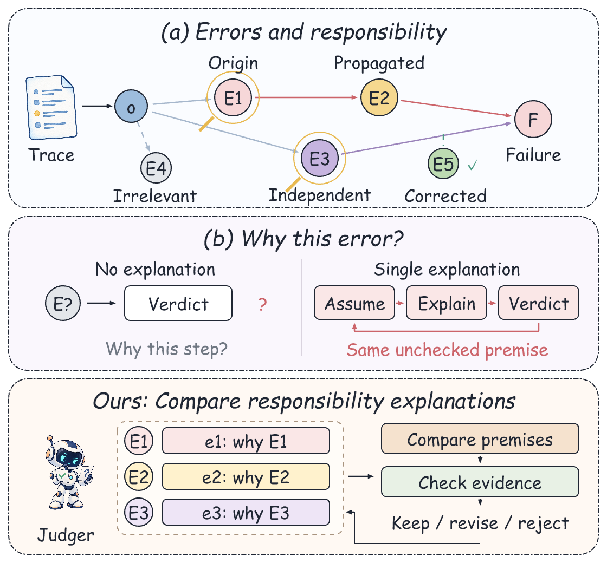

# Neo 的自动科研工具箱

面向日常自动化科研的 Argus / AutoSOTA 接入工具。Argus 负责研究规划、实施和复核；
AutoSOTA 作为可选的代码优化后端；本工具负责版本冻结、运行交接、评测记录、
模型调用记账、故障停止与源码发布。

仓库也收录可复用科研技能：[论文作图 skill](skills/neo-paper-figures/SKILL.md)、
[AI 作图展示与可编辑 PPT](docs/gallery.md)、[提示词与迭代经验](skills/neo-paper-figures/references/prompts.md)。

## AI 辅助论文作图

下面两张图由 AI 根据我的手绘草图、提示词和多轮审美反馈制作。
图示用于展示方法构思与作图能力，不代表算法效果已经得到验证。
图内保留论文使用的英文标注；网页预览裁掉多余留白，可编辑 PPT 保留完整页面。

**论文主图：并行取证、关系分析与候选解释种群。**


**动机图：区分错误与责任，比较不同候选解释。**

<p align="center"></p>

[下载论文主图 PPT](docs/assets/method-population.pptx) ·
[下载动机图 PPT](docs/assets/motivation-portrait.pptx) ·
[查看作图技能、提示词和迭代经验](docs/gallery.md)

## 当前版本

**v0.1.1 实验性版本**，可以公开源码供开发和验证，尚不是开箱即用的无人值守科研平台。
Python 模块和命令保留为 `researchforge`。

- 已实现原版命令行工具适配、任务队列、单工作区写锁、保护评分器哈希和版本冻结。
- 已实现本地模型网关、分类预算、真实用量记账，以及不明调用的保守记录。
- 已实现子进程超时终止、崩溃恢复、AutoSOTA 产物导入和固定分母配对比较。
- 已配置离线测试、Windows / Linux 自动测试流程 和仅源码导出。
- 原版 AutoSOTA 0.2.0 已在断网 Linux 容器中完成 离线演练，生成真实 主提示词，
  该验收没有调用付费模型。此包对应运行时需要 Python 3.11；不能假设新版参数兼容。

**尚未完成的验收**：通过本工具跑通真实付费的
Argus → AutoSOTA → 固定评分器 → Argus 完整闭环；系统重启后的自动服务恢复；
完整 Claude 客户端与扩展思考 协议兼容。已有科研工作区的 Argus 实验结果
不能替代这个独立工具包的端到端验收。

## 快速检查

Python 3.11 或以上；接入层本身无必需第三方 Python 依赖。

```sh
python -m unittest discover -s tests -v
python -m researchforge --state .runtime/window-001 init examples/budget.json
python -m researchforge doctor examples/launchers.json
python -m researchforge --state .runtime/window-001 status
```

Argus、AutoSOTA、模型服务和执行隔离环境需要自行安装配置。示例中的路径和预算
需要按自己的机器调整；示例配置不代表付费授权。不要将个人模型密钥填入源码提交。

## 研究循环

研究方向 → 一项可检验假设 → 冻结代码与协议 → 运行优化批次 → 完整评测 →
比较新增正确与退步案例 → 记录机制发现、成本和负结果 → 决定下一轮。

工具保留两类记录：实验设置与可复现证据；研究发现与待验证结论。
不以更长解释、更规范输出或单例成功替代正式任务指标。

预算策略由使用者授权；网关外的直接调用不受本工具控制。工作目录不是安全沙箱，
必须配置经过核验的容器或其他隔离。遇到结果不明的付费调用，不应盲目重试。
无人值守运行仍要求机器开机、联网且不休眠。

## 发布与许可

```sh
python -m researchforge export dist/neos-autoresearch-tools-v0.1.1-source.zip
```

导出仅包含允许列表内的源码、文档、合成测试、示例和技能，不包含真实 API 配置、
数据集、实验轨迹、上游二进制或私人运行目录。MIT 许可仅覆盖本项目原创代码；
上游项目和服务各自遵守其许可与使用条款。更多接入配置见 [任务示例](docs/task.example.json) 和 [启动器示例](examples/launchers.json)。


## 两个项目如何分工

- **Argus**：维持研究方向，提出假设，安排实验，审查结果并决定下一轮。
- **AutoSOTA**：作为代码优化后端，在冻结的任务、预算和评测规则下尝试修改。
- **本工具箱**：负责交接、运行记录、预算记账、故障停止和结果整理。

本项目是接入层，未重新实现或打包分发两个上游项目。当前已有实际命令行适配与
AutoSOTA 产物导入，但尚未验收通过完整付费闭环，也没有独立证明优化后的刷分收益。

## 可靠运行与结果记录

- 冻结任务目标、代码版本、评分器哈希、数据划分和指标。
- 每个工作区只允许一个写入者；重复提交不会重复创建付费任务。
- 保存进程退出状态、失败原因、产物、成本和配对结果。
- 崩溃或模型调用结果不明时，先核对已有记录，不自动重跑付费工作。
- 新增正确与原正确退步一起统计，不凭单例成功或更长解释宣称进步。
- 预算暂停会停止所管理的后端；工具不能控制绕过网关的直接模型调用。

本机验证：**38 项离线及本地 HTTP 测试通过**。仓库配置了自动测试流程；
具体平台是否通过，以 GitHub 实际运行结果为准。

## 上游项目

- ArgusAgent：研究循环后端，安装来源和版本需与自己的实际环境一致。
- [AutoSOTA](https://github.com/tsinghua-fib-lab/AutoSOTA)：代码优化后端。

未来会继续收录经过实际使用验证的自动科研工具和技能，并保留各项能力的验证边界。
