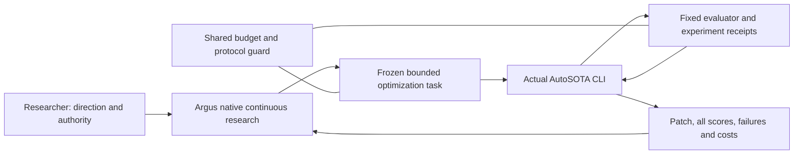

# Neo's Autoresearch Tools

Original integration tooling for Argus and AutoSOTA. Python module and command:
`researchforge` (retained for compatibility). Release status: **experimental v0.1.1**.

中文说明见 [README.zh-CN.md](README.zh-CN.md).

This repository also keeps reusable research skills. See the
[paper-figure gallery](docs/gallery.md) and [Neo's paper-figure skill](skills/neo-paper-figures/SKILL.md).


Reusable experiment operations connecting **native Argus research** with
**actual AutoSOTA code optimization**. Keep one research direction and one
experimental source of truth, while delegating bounded optimization batches.

This is an integration project, not a fork or reimplementation of either system.
It is currently **v0.1, local integration and offline acceptance**. The tests do
not establish unattended paid-research readiness or improved research scores.
An actual complete Argus → AutoSOTA → fixed evaluator → Argus paid cycle remains
an explicit acceptance gate. Do not advertise that gate as passed until its
receipts exist.



## What is implemented

- Versioned task contracts with protected scorer hashes, fixed protocol,
  explicit metric, baseline, data split, required artifacts and finite budgets.
- Actual Argus and AutoSOTA CLI adapters using explicit argv, without shell
  interpolation. No additional LLM research planner.
- Transactional SQLite jobs, idempotent submission, a single workspace writer,
  process receipts, hard wall time, and stopping the backend when a window pauses.
- Crash recovery that **does not automatically replay paid work**. Lost workers
  and ambiguous provider calls require reconciliation with saved receipts.
- Shared API accounting with per-category allocations for planning, optimization,
  review and evaluation. Exhausting a category commits a persistent pause.
- Loopback OpenAI/Anthropic text-and-tool protocol bridge, environment-only real
  credentials, authoritative usage accounting, and conservative unknown billing.
  Extended thinking, images and complete Claude SDK parity are not implemented.
- AutoSOTA score/patch/verdict import, clearly marked as backend-reported until
  checked against the shared evaluator. No automatic score-based promotion.
- Fixed-denominator paired comparisons and multi-metric acceptance guardrails.
- Source-only release export with hashes and a credential/private-path check.
- Native Argus handoff skill, portable offline tests and CI configuration.

## Quick start

Python 3.11+; no Python dependencies are required for the integration layer.
Argus and AutoSOTA are external installations with their own dependencies,
provider configuration, version requirements and terms. Their code is not bundled.

```sh
python -m unittest discover -s tests -v
python -m researchforge --state .runtime/window-001 init examples/budget.json
python -m researchforge doctor examples/launchers.json
python -m researchforge --state .runtime/window-001 status
```

`examples/budget.json` is an example, **not authorization to spend**. Before paid
execution, configure an approved budget, verified sandbox launchers, provider
routes and the actual frozen evaluator. All model clients must use that gateway;
this software cannot budget arbitrary direct calls made outside it.

## Argus ↔ AutoSOTA workflow

1. Argus reads the previous full evaluation and identifies one general mechanism
   hypothesis. It owns research direction, not every code-edit microdecision.
2. Make an owned method-repository copy and batch workspace. Adapt
   `docs/task.example.json` with real paths, scorer hashes and protocol identity.
3. Stage the contract and inspect the CLI plan:

```sh
python -m researchforge plan task.json examples/launchers.json --root project
python -m researchforge --state .runtime/window-001 submit task.json --root project
python -m researchforge --state .runtime/window-001 worker examples/launchers.json --root project
```

4. AutoSOTA runs a bounded batch. The worker imports actual `scores.jsonl`,
   patches and any final verdict into `backend_receipt.json`. Native Argus checks
   official full results and mechanism evidence before planning another batch.
5. Maintain separate experiment-settings and research-findings logs. Preserve
   negative results, paired regressions, source hashes, costs and limitations.

The Argus skill in `skills/researchforge-autosota/SKILL.md` describes this contract.
Install it into the operator's chosen curated skill library; it is not globally
installed or silently injected into an active research project.

## Operate while away

Native Argus is the durable research loop. Run the bounded backend in foreground
under the worker so budget pause can terminate its exact process. If the machine
reboots, use native persisted state and `recover` before any resume. Do not create
a replacement window to get around exhausted budgets.

```sh
python -m researchforge --state .runtime/window-001 pause --reason "operator pause"
# Stop the gateway before reconciling in-flight calls:
python -m researchforge --state .runtime/window-001 recover --gateway-stopped
```

This version intentionally does not guess missing billable results, automatically
clear unknowns, renew spending, answer scope-changing questions, or claim to run
while the host sleeps. A native Needs-you question must remain visible. Future
service/startup integration must preserve these boundaries.

## Models and security

Configure upstream base URL and **environment variable names** using
`examples/gateway.json`. The real provider key belongs only to the gateway
process; backend credentials should be local capability tokens. The gateway
binds only to loopback. Never expose it to an untrusted network.

```sh
# Set the named variables securely in your own environment first.
python -m researchforge --state .runtime/window-001 gateway examples/gateway.json
```

The worker and working directory are not an OS sandbox. Use a verified container
or equivalent isolation in each CLI launcher. Caller-supplied objectives are not
permissions to access secrets, publish, install software, change evaluators, or
expand budgets. AutoSOTA's direct API calls must be routed to the shared gate.
Use a native Anthropic endpoint when extended-thinking compatibility is needed;
this v0.1 bridge refuses that mode rather than fabricating signature parity.

## Release

```sh
python -m researchforge export dist/researchforge-source.zip
```

Only allowlisted source/docs/tests/examples/skills enter the archive. Runtime,
credentials, experiments and upstream distributions are excluded. Review the
archive and licenses before creating a new GitHub repository. No automatic Git
push or publication is performed.

## Upstream and scope

- [AutoSOTA](https://github.com/tsinghua-fib-lab/AutoSOTA): actual optimization CLI.
  The locally available package is 0.2.0; some 0.3 guide options are unsupported
  there. We do not guess `--workspace`, `--resume` or final-review support.
- Argus: externally installed native research/planning/review runtime. Configure
  its executable and curated skill path for each machine.
- MIT applies to this project's original integration source only. Upstream
  binaries, model services, datasets and their conditions remain separate.

See `docs/acceptance.md` for evidence required before unattended rollout.
