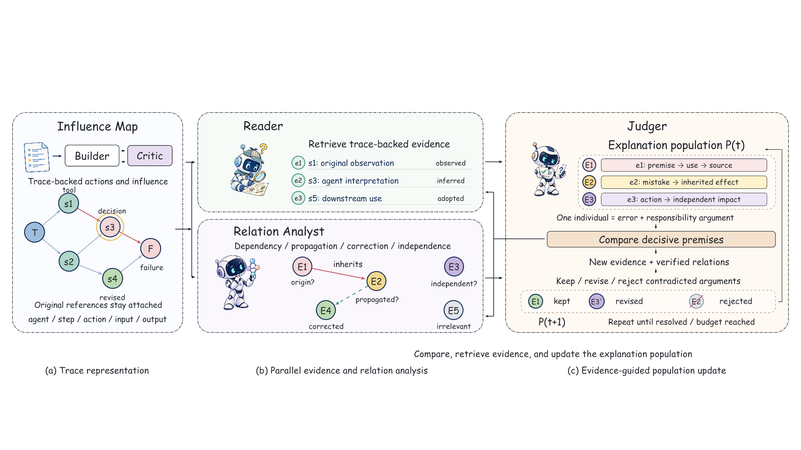

# Neo's Autoresearch Tools

面向日常自动化科研的 Argus / AutoSOTA 接入工具。Argus 负责研究规划、实施和复核；
AutoSOTA 作为可选的代码优化后端；本工具负责版本冻结、运行交接、评测记录、
模型调用记账、故障停止与源码发布。

仓库也收录可复用科研技能：[论文作图 skill](skills/neo-paper-figures/SKILL.md)、
[实际图例与可编辑 PPT](docs/gallery.md)、[提示词与迭代经验](skills/neo-paper-figures/references/prompts.md)。



## 当前版本

**v0.1.1 实验性版本**，可以公开源码供开发和验证，尚不是开箱即用的无人值守科研平台。
Python 模块和命令保留为 `researchforge`。

- 已实现实际 CLI 适配、任务队列、单工作区写锁、保护评分器哈希和版本冻结。
- 已实现本地模型网关、分类预算、真实用量记账，以及不明调用的保守记录。
- 已实现子进程超时终止、崩溃恢复、AutoSOTA 产物导入和固定分母配对比较。
- 已配置离线测试、Windows / Linux CI 和仅源码导出。
- 原版 AutoSOTA 0.2.0 已在断网 Linux 容器中完成 dry-run，生成真实 master prompt，
  该验收没有调用付费模型。此包对应运行时需要 Python 3.11；不能假设新版参数兼容。

**尚未完成的验收**：通过本工具跑通真实付费的
Argus → AutoSOTA → 固定评分器 → Argus 完整闭环；系统重启后的自动服务恢复；
完整 Claude SDK 与 extended-thinking 协议兼容。已有科研工作区的 Argus 实验结果
不能替代这个独立工具包的端到端验收。

## 快速检查

Python 3.11 或以上；接入层本身无必需第三方 Python 依赖。

```sh
python -m unittest discover -s tests -v
python -m researchforge --state .runtime/window-001 init examples/budget.json
python -m researchforge doctor examples/launchers.json
python -m researchforge --state .runtime/window-001 status
```

Argus、AutoSOTA、模型服务和执行隔离环境需要自行安装配置。示例中的路径和预算
需要按自己的机器调整；示例配置不代表付费授权。不要将本机密钥填入源码提交。

## 研究循环

研究方向 → 一项可检验假设 → 冻结代码与协议 → 运行优化批次 → 完整评测 →
比较新增正确与退步案例 → 记录机制发现、成本和负结果 → 决定下一轮。

工具保留两类记录：实验设置与可复现证据；研究发现与待验证结论。
不以更长解释、更规范输出或单例成功替代正式任务指标。

预算策略由使用者授权；网关外的直接调用不受本工具控制。工作目录不是安全沙箱，
必须配置经过核验的容器或其他隔离。遇到结果不明的付费调用，不应盲目重试。
无人值守运行仍要求机器开机、联网且不休眠。

## 发布与许可

```sh
python -m researchforge export dist/neos-autoresearch-tools-v0.1.1-source.zip
```

导出仅包含允许列表内的源码、文档、合成测试、示例和技能，不包含真实 API 配置、
数据集、实验轨迹、上游二进制或私人运行目录。MIT 许可仅覆盖本项目原创代码；
上游项目和服务各自遵守其许可与使用条款。更多配置见 [英文说明](README.md)。
